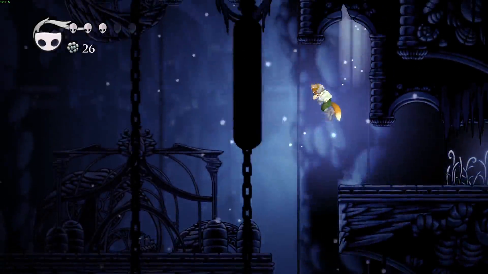

# Hollow Knight: Melee

Play Hollow Knight as Super Smash Bros. Melee characters, with movement and combat that match Melee NTSC 1.02
frame for frame.

The mod doesn't imitate Melee. It runs Melee's own game code, statically recompiled from your ISO into a native
library (`libmelee_core`). Hollow Knight's rooms become Melee collision, and Fox's hits, hitlag, knockback, grabs and
sounds come from Melee itself.

*Fox in Hollow Knight: [watch the clip](media/preview.mp4) (1080p, 38 s).*

**Status:** early development. All 26 Melee characters are playable: Fox to start, the others unlocked by charms and
chosen at a bench. Windows and Linux.

## Install

1. Download **HollowKnightMeleeInstaller.exe** (Windows) or **HollowKnightMeleeInstaller-linux** (Linux) from the
   [latest release](https://github.com/9je/hollow-knight-melee/releases).
2. Run it. It finds Hollow Knight, asks for your Melee ISO (pick it in the window or drag it in), backs up the game and your saves (once), installs the Modding
   API, and builds the Melee core from your ISO (5-10 minutes the first time). Run it again any time to update; it
   updates itself.
3. Start Hollow Knight from Steam.

Windows may warn that the installer is from an unknown publisher (it isn't signed): choose "More info", then "Run
anyway". To uninstall, run the installer and choose Uninstall: the game's own files come back, saves untouched.

## Playing

- A GameCube controller on a Wii U/Mayflash adapter plays exactly as in Melee (Windows: install the adapter's WinUSB
  driver once with Zadig, as for Dolphin). A gamepad or keyboard works too.
- D-pad left: interact (talk, read, sit). D-pad right: tap for the inventory, hold for the map. D-pad down: Focus (heal). Start: pause.
- Characters: the inventory's last page, after the Map. Choose a character and its color there while sitting at a bench.
- Stuck? Pause, then **Reset character** takes you back to your last bench.

## Requirements

- Hollow Knight 1.5 (Steam) and the [Hollow Knight Modding API](https://github.com/hk-modding/api).
- Your own copy of Super Smash Bros. Melee NTSC 1.02 as an ISO. Nothing from Melee is included in this repository
  or its releases: everything Melee-derived is built on your PC from your ISO.
- A GameCube controller on a Wii U/Mayflash adapter (recommended), or a gamepad or keyboard.

## Layout

- `tools/`: the PowerPC to C recompiler and the ISO and asset tools (Python).
- `core/`: the runtime that hosts recompiled Melee (`libmelee_core`) and its tests.
- `mod/`: the Hollow Knight mod (`FoxMod`, `FoxCore`) and its install scripts.

## Building (developers)

Linux: `mod/install.sh` (needs dev.toml with your ISO). The player-side build is `ssbmhk-build-core`
(tools/), which the installer runs; `make -C core win-dll` cross-builds the Windows core with zig.

## Licence

GPL-2.0-or-later (see `LICENSE`). Parts of the floating-point emulation are derived from Dolphin (GPL-2.0-or-later).
Super Smash Bros. Melee and Hollow Knight belong to their owners; this project ships none of their files.
